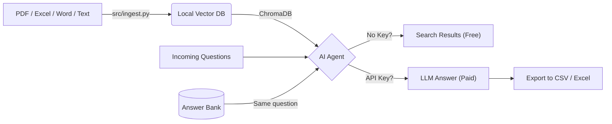

# AI Vendor Response Agent


**An automated RAG (Retrieval-Augmented Generation) agent designed to streamline Third-Party Risk Management (TPRM).**

This tool ingests your company's "Source of Truth" security artifacts and uses a local Vector Database to draft answers to incoming security questionnaires.

### Hybrid AI Engine
* **Free / Local Mode:** If no API key is provided, the agent runs **100% offline** using local HuggingFace embeddings (CPU) to search and retrieve relevant evidence.
* **Enterprise Mode:** If an Anthropic or OpenAI API key is detected, it generates full answers from the retrieved evidence (Claude or GPT-4 by default; set `LLM_PROVIDER` and `LLM_MODEL` to choose). Questions the evidence does not answer are returned as "Review Required".

## Key Features

* **Document Ingestion:** Ingests and indexes **PDFs**, **Excel/CSV** (previous questionnaires), **Word Docs**, and **plain text**. Website URL ingestion is not implemented.
* **Audit-Ready Citations:** Every answer includes a reference to the source document, and the page number for PDFs.
* **Bulk Processing:** Fills a CSV from the command line, or an Excel questionnaire in place from the web app with its formatting preserved.
* **Review Flagging:** Questions the knowledge base does not answer are flagged "Review Required". Auto-Fill leaves those cells blank and lists them for manual review, so tool messages never reach an assessor.
* **Answer Bank:** Reviewed answers are stored and reused. A bank answer is reused only when the incoming question uses the same words as the stored one, and can be scoped by product and subsidiary.
* **Review Dates:** Each uploaded document has a review date. Documents past that date are dropped from the index until the date is renewed.
* **Local Vector Store:** Uses `ChromaDB` locally—your sensitive embeddings are not stored in a third-party cloud vector provider.

## Architecture



## Usage

### 1. Setup

Clone the repository and install dependencies:

```bash
git clone https://github.com/codyjkeller/ai-vendor-response-agent.git
cd ai-vendor-response-agent
pip install -r requirements.txt
```

### 2. Configure Environment (Optional)

* **For Search-Only (Free):** You can skip this step.
* **For AI Answers (Paid):** Copy `.env.example` to `.env` in the root directory and set a key:

```bash
ANTHROPIC_API_KEY=sk-ant-your-key-here
# or
OPENAI_API_KEY=sk-your-key-here
LLM_MODEL=gpt-4o  # Optional: overrides the provider default
```

### 3. Build the Knowledge Base

Place your security artifacts into the `data/` folder. The tool supports:
* **PDFs:** Policies, SOC 2 Reports.
* **Excel / CSV:** Previous questionnaires (it reads all text).
* **Word:** Policy documents (`.docx`).
* **Text:** Plain `.txt` files.

Run the ingestion script to build the brain:

```bash
python src/ingest.py
```

`data/` is gitignored. The fictional sample documents live in `sample_data/` and are indexed only in demo mode, labelled `SAMPLE - ` in citations.

### 4. Run the Agent

**Option A: Bulk Processing (Recommended)**
Feed the agent a CSV file containing a list of questions (must have a column named `Question`).

```bash
python src/agent.py --file questions.csv
```

**Option B: Interactive Mode**
Chat with your security policies in the terminal.

```bash
python src/agent.py --interactive
```

**Option C: Web GUI (AuditFlow Enterprise)**
Launch the Streamlit dashboard: Auto-Fill for Excel questionnaires, Answer Bank, Knowledge Base uploader, and an interactive chat.

```bash
streamlit run src/app.py
```

The web app requires sign-in. See **Authentication** below, or run the demo:

```bash
AUDITFLOW_DEMO_MODE=true streamlit run src/app.py
```

## Authentication

The web app signs users in through an OpenID Connect identity provider (Microsoft Entra ID, Okta, Google Workspace, Auth0, Keycloak) using Streamlit's built-in `st.login()`. MFA and password policy are enforced by the provider.

1. Register an application with your provider. Set the redirect URI to `<app URL>/oauth2callback` and include the `email` scope.
2. Copy `.streamlit/secrets.toml.example` to `.streamlit/secrets.toml` and fill in the values. This file is gitignored.
3. Set `AUDITFLOW_ADMIN_EMAILS` to the e-mail addresses that should be Administrators.

If no provider is configured and demo mode is off, the app refuses access.

### Roles

| Role | Search, chat, Auto-Fill | Upload documents, add answers | Delete documents, change roles |
| :--- | :---: | :---: | :---: |
| Read Only (default for new users) | Yes | No | No |
| Analyst, Manager | Yes | Yes | No |
| Administrator | Yes | Yes | Yes |

Administrators assign roles under **Settings → Roles & Permissions → User Roles**.

### Demo mode

`AUDITFLOW_DEMO_MODE=true` replaces sign-in with a simulated screen that checks no credentials, shows sample dashboard figures and the sample Gap Analysis and Projects pages, and indexes `sample_data/`. Everything it adds is labelled as sample or demo. Do not use it with real documents or expose it to a network.

## Output Format

The command line writes `completed_responses.csv` containing:

| Question | AI_Response | Status | Evidence |
| :--- | :--- | :--- | :--- |
| **Do you use MFA?** | Yes, we enforce MFA for all employees via Okta. | 🤖 AI Generated | Access_Policy.pdf (Pg. 4) |
| **Is data encrypted at rest?** | Yes, AES-256 via AWS KMS. | ✅ Verified (Bank) | Answer Bank Match (100%) |
| **Do you have ISO 27001?** | Review Required | ⚠️ Review | Access_Policy.pdf (Pg. 1) |

AI Generated answers are drafts. Check each against its evidence before sending it to an assessor.

## Development

```bash
pip install -r requirements-dev.txt
pytest
ruff check .
bandit -r src -ll
```

CI runs the same checks on every push and pull request.

## Data Privacy Note

Do not commit the `data/` folder, `.env` file, `.streamlit/secrets.toml`, `auditflow.db`, `audit_log.csv`, or `chroma_db/` directory to GitHub. The included `.gitignore` covers all of them.

*While the Vector DB is local, if an Anthropic or OpenAI key is set, retrieved text chunks are sent to that provider for generation. If an OpenAI key is set, document chunks are also sent to OpenAI to be embedded. Ensure this aligns with your company's AI usage policy.*

See [SECURITY.md](SECURITY.md) for reporting vulnerabilities.

## License

MIT
